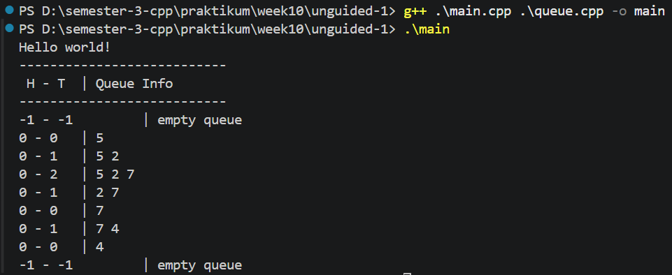
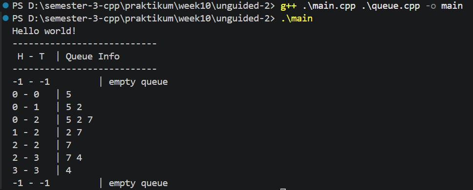
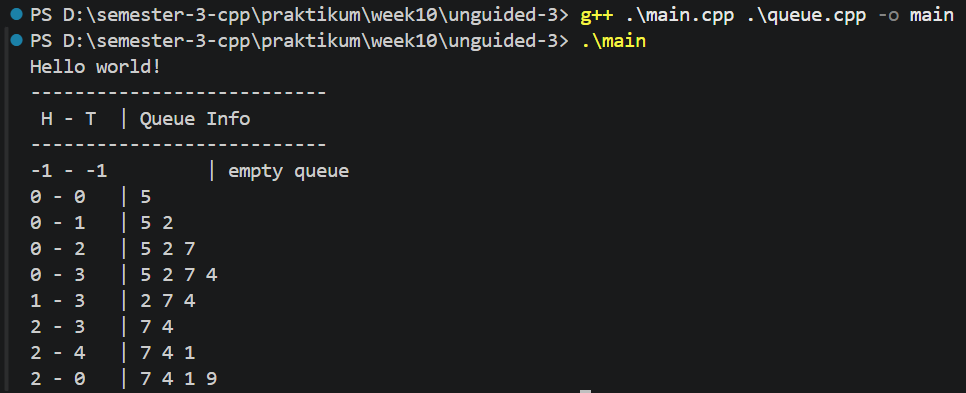

# <h1 align="center">Laporan Praktikum Modul 8 - QUEUE </h1>
<p align="center">Mukhammad Ari Trianirto - 109082530027</p>

## Dasar Teori
Queue (antrean) merupakan salah satu bentuk struktur data linear yang beroperasi menggunakan prinsip FIFO (First In First Out), di mana elemen data yang pertama kali dimasukkan ke dalam antrean akan menjadi elemen pertama yang diakses atau dikeluarkan [1]. Berbeda dengan stack yang membatasi akses hanya pada satu ujung teratas (Top), seluruh operasi pada queue melibatkan dua ujung pintu akses yang terpisah, yaitu penambahan elemen baru pada bagian belakang antrean yang disebut Tail dan pengambilan elemen pada bagian depan antrean yang disebut Head [1]. Karakteristik ini menyerupai sistem antrean di dunia nyata, seperti antrean loket tiket, serta berperan penting dalam komputasi modern seperti penjadwalan proses CPU, pengelolaan antrean cetak (print spooling), hingga manajemen paket data pada jaringan [1].   

Secara struktural, queue dapat diimplementasikan menggunakan dua pendekatan representasi memori, yaitu representasi pointer (linked list) secara dinamis dan representasi tabel (array) secara statis [2]. Pada representasi pointer (baik menggunakan singly linked list maupun doubly linked list), jumlah elemen antrean bersifat tidak terbatas selama memori tersedia karena melibatkan manajemen memori berupa alokasi dan dealokasi node secara dinamis, di mana antrean dinyatakan kosong apabila pointer Head dan Tail bernilai Nil [2]. Sebaliknya, representasi tabel memanfaatkan array berindeks dengan kapasitas maksimum tertentu (IMax atau NMax) tanpa manajemen memori dinamis, yang terbagi ke dalam tiga alternatif mekanisme pergerakan indeks: Alternatif 1 dengan posisi Head diam di indeks awal dan Tail bergerak maju (mengharuskan pergeseran seluruh elemen maju saat elemen dihapus), Alternatif 2 dengan Head dan Tail yang sama-sama bergerak maju (lebih efisien namun dapat memicu kondisi penuh semu ketika Tail mencapai batas IMax), serta Alternatif 3 (circular buffer) di mana indeks Head dan Tail dapat berputar kembali ke indeks awal untuk mengatasi penuh semu tanpa perlu menggeser elemen [2].   

Operasi fundamental dalam Abstract Data Type (ADT) Queue bertumpu pada dua prosedur utama, yakni penyisipan elemen (Insert atau Enqueue) dan penghapusan elemen (Delete atau Dequeue), yang didukung oleh fungsi primitif seperti CreateQueue, isEmpty, isFull, dan printInfo [3]. Pada operasi Enqueue, elemen baru selalu disisipkan di posisi paling akhir (Tail)—pada representasi pointer dilakukan dengan mengalokasikan elemen baru P, mengarahkan (Q.tail)->next = P, lalu memperbarui Q.tail = P, sedangkan pada representasi tabel dilakukan dengan memajukan indeks Tail sebelum menyimpan nilai data ke dalam array [3]. Sebaliknya, operasi Dequeue mengambil elemen yang berada paling depan (Head), yaitu dengan menampung elemen Q.head ke variabel sementara P lalu menggeser Q.head ke elemen berikutnya (P->next) pada representasi pointer, atau dengan menggeser elemen maupun memajukan posisi indeks Head sesuai alternatif tabel yang digunakan [3].

## Guided 

### 1. Queue Representasi Pointer

#### Queue.h

```C++
#ifndef QUEUE_H_INCLUDE
#define QUEUE_H_INCLUDE

#include <iostream>
using namespace std;

#define Nil NULL

typedef bool boolean;
typedef int infotype;
typedef struct elmQ *address;

struct elmQ {
    infotype info;
    address next;
};

struct queue {
    address head, tail;
};

boolean isEmpty(queue Q);
void CreateQueue(queue &Q);
address alokasi(infotype X);
void dealokasi(address P);
address findElm(queue Q, infotype X);
boolean fFindElm(queue Q, address P);
void insert(queue &Q, address P);
void deleteQueue(queue &Q, address &P);
void printInfo(queue Q);
int nbList(queue Q);
void delAll(queue &Q);

#endif
```

### queue.cpp

```C++
#include "queue.h"

boolean isEmpty(queue Q) {
    return (Q.head == Nil);
}

void CreateQueue(queue &Q) {
    Q.head = Nil;
    Q.tail = Nil;
}

address alokasi(infotype X) {
    address P = new (nothrow) elmQ;
    if (P != Nil) {
        P->info = X;
        P->next = Nil;
    }
    return P;
}

void dealokasi(address P) {
    delete P;
}

address findElm(queue Q, infotype X) {
    address P = Q.head;
    while (P != Nil) {
        if (P->info == X) {
            return P;
        }
        P = P->next;
    }
    return Nil;
}

boolean fFindElm(queue Q, address P) {
    address R = Q.head;
    while (R != Nil) {
        if (R == P) {
            return true;
        }
        R = R->next;
    }
    return false;
}

void insert(queue &Q, address P) {
    if (isEmpty(Q)) {
        Q.head = P;
        Q.tail = P;
    } else {
        (Q.tail)->next = P;
        Q.tail = P;
    }
}

void deleteQueue(queue &Q, address &P) {
    P = Q.head;
    if (Q.head == Q.tail) {
        Q.head = Nil;
        Q.tail = Nil;
    } else {
        Q.head = P->next;
    }
    P->next = Nil;
}

void printInfo(queue Q) {
    if (isEmpty(Q)) {
        cout << "Queue kosong" << endl;
    } else {
        address P = Q.head;
        while (P != Nil) {
            cout << P->info << " ";
            P = P->next;
        }
        cout << endl;
    }
}

int nbList(queue Q) {
    int jumlah = 0;
    address P = Q.head;
    while (P != Nil) {
        jumlah++;
        P = P->next;
    }
    return jumlah;
}

void delAll(queue &Q) {
    address P;
    while (!isEmpty(Q)) {
        deleteQueue(Q, P);
        dealokasi(P);
    }
}
```

### main.cpp

```C++
#include <iostream>
#include "queue.h"
using namespace std;

int main() {
    queue Q;
    address P;

    CreateQueue(Q);
    cout << "isEmpty : " << isEmpty(Q) << endl;
    printInfo(Q);

    insert(Q, alokasi(5));
    insert(Q, alokasi(2));
    insert(Q, alokasi(7));
    cout << "Setelah insert 5, 2, 7" << endl;
    printInfo(Q);
    cout << "nbList ; " << nbList(Q) << endl;

    P = findElm(Q, 2);
    if (P != Nil) {
        cout << "findElm(2) ketemu, info = " << P->info << endl;
        cout << "fFindElm(9) tidak ketemu" << endl;
    }
    if (findElm(Q, 9) == Nil) {
        cout << "findElm(9) tidak ketemu" << endl;
    }

    deleteQueue(Q, P);
    cout << "Setelah delete, elemen yang keluar = " << P->info << endl;
    dealokasi(P);
    printInfo(Q);

    delAll(Q);
    cout << "Setelah delAll" << endl;
    printInfo(Q);
    cout << "isEmpty : " << isEmpty(Q) << endl;

    return 0;
}
```
Program ini mengimplementasikan *Abstract Data Type* (ADT) *Queue* menggunakan representasi fisik *pointer* (*singly linked list*) secara dinamis yang terdiri dari elemen bertipe `elmQ` (`info` bertipe *integer* dan *pointer* `next`) serta penanda `head` dan `tail`. Di dalam fungsi `main`, antrean diinisialisasi menggunakan `CreateQueue(Q)` sehingga kondisi awal kosong (`head` dan `tail` bernilai `Nil`), kemudian diisi tiga elemen berturut-turut (`5`, `2`, dan `7`) pada bagian akhir antrean (`tail`) melalui prosedur `insert` dan fungsi `alokasi`. Selanjutnya, program menguji pencarian alamat elemen menggunakan `findElm` dan `fFindElm`, mengeluarkan elemen paling depan (`5`) dari posisi `head` menggunakan prosedur `deleteQueue(Q, P)` disertai pembebasan memori melalui `dealokasi(P)`, hingga akhirnya mengosongkan seluruh sisa elemen antrean menggunakan prosedur `delAll(Q)`.

### 2. Queue Representasi Table

#### Queue.h

```C++
#ifndef QUEUE_H
#define QUEUE_H

#include <iostream>
using namespace std;

const int MAKSIMAL = 5;

struct queue {
    string nama[MAKSIMAL];
    int head;
    int tail;
};

bool isFull(queue Q);
bool isEmpty(queue Q);
void CreateQueue(queue &Q);
void enQueue(queue &Q, string nama);
void deQueue(queue &Q);
void viewQueue(queue Q);

#endif
```

### queue.cpp

```C++
#include "queue.h"
#include <iostream>

using namespace std;

// NOTE : 
// Implementasi 1 = head diam, tail bergerak (Queue Linear Statis, kerana head nya tetap diam)
// Implementasi 2 = head bergerak, tail bergerak (Queue Linear Dinamis, karena head & tail nya sama-sama bergerak)
// Implementasi 3 = head dan tail berputar (Queue Circular, karena jika udh mentok tapi masih ada space, diputar sehingga tail bisa ada didepan head)

bool isEmpty(queue Q){
    if(Q.head == -1 && Q.tail == -1){
        return true;
    } else {
        return false;
    }
}

//isFull implmenetasi 1 & 2
bool isFull(queue Q){
    if(Q.tail == MAKSIMAL - 1){
        return true;
    } else {
        return false;
    }
}

// //isFull implementasi 3
// bool isFull(queue Q){
//     if((Q.tail + 1) % MAKSIMAL == Q.head){
//         return true;
//     } else {
//         return false;
//     }
// }

void CreateQueue(queue &Q){ //terbentuk queue dengan head = -1 dan tail = -1 
    Q.head = -1;
    Q.tail = -1;
}


//enqueue implementasi 1 & 2
void enQueue(queue &Q, string nama){
    if(isFull(Q) == true){
        cout << "Queue sudah penuh!" << endl;
    } else {
        if(isEmpty(Q) == true){
            Q.head = Q.tail = 0;
        } else {
            Q.tail++;
        }
        Q.nama[Q.tail] = nama;
        cout << "nama " << nama << " berhasil ditambahkan kedalam queue!" << endl;
    }
}

// //enQueue implementasi 3
// void enQueue(queue &Q, string nama){
//     if(isFull(Q) == true){
//         cout << "Queue sudah penuh!" << endl;
//     } else {
//         if(isEmpty(Q) == true){
//             Q.head = Q.tail = 0;
//         } else {
//             Q.tail = (Q.tail + 1) % MAKSIMAL; // bergerak melingkar
//         }
//         Q.nama[Q.tail] = nama;
//         cout << "nama " << nama << " berhasil ditambahkan kedalam queue!" << endl;
//     }
// }

//dequeue implementasi 1
void deQueue(queue &Q){
    if(isEmpty(Q) == true){
        cout << "Queue kosong!" << endl;
    } else {
        cout << "Mengahapus data " << Q.nama[Q.head] << "..." << endl;
        for(int i = 0; i < Q.tail; i++){
            Q.nama[i] =  Q.nama[i+1];
        }
        Q.tail--;
        if(Q.tail < 0){ //kalo semua isi queue nya udh dikelaurin, set head & tail ke -1
            Q.head = -1;
            Q.tail = -1;
        }
    }
}

// //dequeue implementasi 2
// void deQueue(queue &Q){
//     if(isEmpty(Q) == true){
//         cout << "Queue kosong!" << endl;
//     } else {
//         cout << "Mengahapus data " << Q.nama[Q.head] << "..." << endl;
//         Q.head++;
//         if(Q.head > Q.tail){ //kalo elemennya udh abis (head akan lebih 1 dari tail), maka reset ulang head & tail ke -1
//             Q.head = -1;
//             Q.tail = -1;
//         }
//     }
// }

// //deQueue implementasi 3
// void deQueue(queue &Q){
//     if(isEmpty(Q) == true){
//         cout << "Queue kosong!" << endl;
//     } else {
//         cout << "Mengahapus data " << Q.nama[Q.head] << "..." << endl;
//         if(Q.head == Q.tail){ //kalo elemennya tinggal 1, langsungkan saja head & tail nya reset ke -1
//             Q.head = -1;
//             Q.tail = -1;
//         } else {
//             Q.head = (Q.head + 1) % MAKSIMAL; // bergerak melingkar
//         }
//     }
// }

//viewQueue implementasi 1 & 2
void viewQueue(queue Q){
    if(isEmpty(Q) == true){
        cout << "Queue kosong!" << endl;
    } else {
        for(int i = Q.head; i <= Q.tail; i++){
            cout << i -  Q.head + 1 << ". " << Q.nama[i] << endl;
        }
    }
    cout << endl;
}

// //viewQueue implementasi 3
// void viewQueue(queue Q){
//     if(isEmpty(Q) == true){
//         cout << "Queue kosong!" << endl;
//     } else {
//         int i = Q.head;
//         int count = 1;
//         while(true){
//             cout << count << ". " << Q.nama[i] << endl;
//             if(i == Q.tail){
//                 break;
//             }
//             i = (i + 1) % MAKSIMAL;
//             count++;
//         }   
//     }
// }
```

### main.cpp

```C++
#include "queue.h"
#include <iostream>

using namespace std;

int main(){
    queue Q;

    CreateQueue(Q);
    enQueue(Q, "Dimas");
    enQueue(Q, "Arvin");
    enQueue(Q, "Rizal");
    enQueue(Q, "Hafizh");
    enQueue(Q, "Fathur");
    enQueue(Q, "Daffa");
    cout << endl;

    cout << "--- Isi Queue Setelah enQueue ---" << endl;
    viewQueue(Q);
    cout << endl;

    deQueue(Q);
    deQueue(Q);
    deQueue(Q);
    deQueue(Q);
    // deQueue(Q);
    // deQueue(Q);
    cout << endl;

    cout << "--- Isi Queue Setelah deQueue ---" << endl;
    viewQueue(Q);

    return 0;
}
```
Program ini mengimplementasikan ADT *Queue* menggunakan representasi tabel (*array* statis) berkapasitas maksimal 5 elemen (`MAKSIMAL = 5`) bertipe `string` dengan penanda indeks `head` dan `tail` yang diinisialisasi ke nilai `-1` saat antrean kosong. Kode program pada `queue.cpp` mendemonstrasikan tiga alternatif mekanisme antrean *array*, di mana kode yang aktif menerapkan Alternatif 1 (`head` diam di indeks `0` dan `tail` bergerak maju), serta menyertakan blok komentar untuk Alternatif 2 (`head` dan `tail` bergerak maju) dan Alternatif 3 (*circular queue* menggunakan operasi modulo `% MAKSIMAL`). Pada fungsi `main`, dilakukan enam kali pemanggilan `enQueue` sehingga lima nama pertama berhasil masuk ke antrean sedangkan nama keenam (`"Daffa"`) ditolak karena antrean sudah penuh (`isFull`), kemudian diikuti empat kali pemanggilan `deQueue` yang menghapus elemen dari indeks `head` sekaligus menggeser sisa elemen maju satu indeks ke depan sehingga menyisakan satu elemen terakhir (`"Fathur"`).

## Unguided

### 1. Implementasi ADT Queue Menggunakan Array (Alternatif 1)

#### queue.h
```cpp
#ifndef QUEUE_H
#define QUEUE_H

#include <iostream>
using namespace std;

typedef int infotype;

struct Queue {
    infotype info[5];
    int head;
    int tail;
};

void createQueue(Queue &Q);
bool isEmptyQueue(Queue Q);
bool isFullQueue(Queue Q);
void enqueue(Queue &Q, infotype x);
infotype dequeue(Queue &Q);
void printInfo(Queue Q);

#endif
```

#### queue.cpp
```C++
#include "queue.h"

void createQueue(Queue &Q) {
    Q.head = -1;
    Q.tail = -1;
}

bool isEmptyQueue(Queue Q) {
    return (Q.head == -1 && Q.tail == -1);
}

bool isFullQueue(Queue Q) {
    return (Q.tail == 4); // Maksimal indeks 4 karena array[5]
}

void enqueue(Queue &Q, infotype x) {
    if (isFullQueue(Q)) {
        cout << "Queue penuh!" << endl;
    } else {
        if (isEmptyQueue(Q)) {
            Q.head = 0;
            Q.tail = 0;
        } else {
            Q.tail++;
        }
        Q.info[Q.tail] = x;
    }
}

infotype dequeue(Queue &Q) {
    infotype x = -1; 
    if (isEmptyQueue(Q)) {
        cout << "Queue kosong!" << endl;
    } else {
        x = Q.info[Q.head]; // Elemen terdepan selalu di indeks head (0)
        if (Q.head == Q.tail) {
            // Jika hanya tersisa 1 elemen, kembalikan ke kondisi kosong
            createQueue(Q);
        } else {
            // Menggeser semua elemen maju satu indeks ke depan (Alternatif 1)
            for (int i = 0; i < Q.tail; i++) {
                Q.info[i] = Q.info[i + 1];
            }
            Q.tail--;
        }
    }
    return x;
}

void printInfo(Queue Q) {
    cout << Q.head << " - " << Q.tail << " \t| ";
    if (isEmptyQueue(Q)) {
        cout << "empty queue" << endl;
    } else {
        for (int i = Q.head; i <= Q.tail; i++) {
            cout << Q.info[i] << " ";
        }
        cout << endl;
    }
}
```

#### main.cpp
```C++
#include <iostream>
#include "queue.h"

using namespace std;

int main() {
    cout << "Hello world!" << endl;
    Queue Q;
    createQueue(Q);
    
    cout << "---------------------------" << endl;
    cout << " H - T \t| Queue Info" << endl;
    cout << "---------------------------" << endl;
    
    printInfo(Q);
    enqueue(Q, 5); printInfo(Q);
    enqueue(Q, 2); printInfo(Q);
    enqueue(Q, 7); printInfo(Q);
    dequeue(Q); printInfo(Q);
    dequeue(Q); printInfo(Q);
    enqueue(Q, 4); printInfo(Q);
    dequeue(Q); printInfo(Q);
    dequeue(Q); printInfo(Q);
    
    return 0;
}
```

#### Output Unguided 1 :
##### Output 1


Program ini mengimplementasikan Abstract Data Type (ADT) Queue menggunakan representasi array statis berkapasitas 5 elemen dengan mekanisme Alternatif 1. Pada mekanisme ini, nilai indeks head dibuat statis (diam) di indeks 0 apabila antrean tidak kosong, sedangkan indeks tail bergerak menyesuaikan jumlah elemen yang masuk. Saat fungsi enqueue dipanggil, tail akan bertambah nilainya. Sebaliknya, saat fungsi dequeue dipanggil untuk mengeluarkan elemen terdepan, seluruh elemen yang tersisa di belakangnya harus digeser maju secara manual ke indeks sebelumnya (Q.info[i] = Q.info[i+1]), lalu nilai tail dikurangi satu. Meskipun merepresentasikan sistem antrean di dunia nyata (orang bergeser maju jika antrean depannya kosong), mekanisme penggeseran memori array ini memiliki komputasi yang kurang efisien jika ukuran data besar.

### 2. Implementasi ADT Queue Menggunakan Array (Alternatif 2)

#### queue.h
```C++
#ifndef QUEUE_H
#define QUEUE_H

#include <iostream>
using namespace std;

typedef int infotype;

struct Queue {
    infotype info[5];
    int head;
    int tail;
};

void createQueue(Queue &Q);
bool isEmptyQueue(Queue Q);
bool isFullQueue(Queue Q);
void enqueue(Queue &Q, infotype x);
infotype dequeue(Queue &Q);
void printInfo(Queue Q);

#endif
```

#### queue.cpp
```C++
#include "queue.h"

void createQueue(Queue &Q) {
    Q.head = -1;
    Q.tail = -1;
}

bool isEmptyQueue(Queue Q) {
    return (Q.head == -1 && Q.tail == -1);
}

// Pada Alternatif 2, antrean dikatakan benar-benar penuh 
// HANYA JIKA tail sudah mencapai indeks akhir DAN head berada di indeks awal (0)
bool isFullQueue(Queue Q) {
    return (Q.tail == 4 && Q.head == 0); 
}

void enqueue(Queue &Q, infotype x) {
    if (isFullQueue(Q)) {
        cout << "Queue penuh!" << endl;
    } else {
        if (isEmptyQueue(Q)) {
            Q.head = 0;
            Q.tail = 0;
            Q.info[Q.tail] = x;
        } else {
            // Cek kondisi antrean penuh "semu" (tail di akhir, tapi head > 0)
            if (Q.tail == 4 && Q.head > 0) {
                // Geser seluruh elemen ke depan untuk menciptakan ruang kosong
                int geser = Q.head;
                for (int i = Q.head; i <= Q.tail; i++) {
                    Q.info[i - geser] = Q.info[i];
                }
                Q.tail = Q.tail - geser;
                Q.head = 0; // Kembalikan head ke 0 setelah digeser
            }
            Q.tail++;
            Q.info[Q.tail] = x;
        }
    }
}

infotype dequeue(Queue &Q) {
    infotype x = -1; 
    if (isEmptyQueue(Q)) {
        cout << "Queue kosong!" << endl;
    } else {
        x = Q.info[Q.head];
        if (Q.head == Q.tail) {
            // Jika hanya tersisa 1 elemen, kembalikan ke kondisi kosong
            createQueue(Q);
        } else {
            // Pada Alternatif 2, elemen TIDAK digeser saat dequeue,
            // melainkan indeks head yang bergerak maju.
            Q.head++;
        }
    }
    return x;
}

void printInfo(Queue Q) {
    cout << Q.head << " - " << Q.tail << " \t| ";
    if (isEmptyQueue(Q)) {
        cout << "empty queue" << endl;
    } else {
        for (int i = Q.head; i <= Q.tail; i++) {
            cout << Q.info[i] << " ";
        }
        cout << endl;
    }
}
```

#### main.cpp
```C++
#include <iostream>
#include "queue.h"

using namespace std;

int main() {
    cout << "Hello world!" << endl;
    Queue Q;
    createQueue(Q);
    
    cout << "---------------------------" << endl;
    cout << " H - T \t| Queue Info" << endl;
    cout << "---------------------------" << endl;
    
    printInfo(Q);
    enqueue(Q, 5); printInfo(Q);
    enqueue(Q, 2); printInfo(Q);
    enqueue(Q, 7); printInfo(Q);
    
    // Perhatikan nilai head akan bertambah (bergerak) saat dequeue
    dequeue(Q); printInfo(Q);
    dequeue(Q); printInfo(Q);
    
    enqueue(Q, 4); printInfo(Q);
    dequeue(Q); printInfo(Q);
    dequeue(Q); printInfo(Q);
    
    return 0;
}
```
### Output Unguided 2 :

##### Output 1


Program ini memodifikasi implementasi ADT Queue array statis dengan menerapkan mekanisme Alternatif 2. Pada mekanisme ini, setiap kali elemen dihapus melalui prosedur dequeue, kita tidak lagi membuang waktu komputasi untuk menggeser seluruh sisa elemen ke depan; sebagai gantinya, indeks head dibiarkan bergerak maju menunjuk ke elemen berikutnya. Namun, pergerakan head ini akan memicu munculnya kondisi penuh "semu", yaitu ketika nilai tail sudah menabrak indeks maksimum array (Q.tail == 4) meskipun sebenarnya masih ada ruang kosong di indeks awal yang ditinggalkan oleh head (Q.head > 0). Untuk mengatasi kondisi penuh semu tersebut, pada fungsi enqueue ditambahkan logika khusus: jika tail mencapai batas akhir namun antrean belum benar-benar penuh, seluruh elemen akan digeser beramai-ramai ke indeks 0 (indeks head direset menjadi 0 dan tail disesuaikan) agar elemen baru tetap dapat disisipkan.

### 3. Implementasi ADT Queue Menggunakan Array (Alternatif 3 / Circular Queue)

#### queue.h

```C++
#ifndef QUEUE_H
#define QUEUE_H

#include <iostream>
using namespace std;

typedef int infotype;
const int MAKSIMAL = 5;

struct Queue {
    infotype info[MAKSIMAL];
    int head;
    int tail;
};

void createQueue(Queue &Q);
bool isEmptyQueue(Queue Q);
bool isFullQueue(Queue Q);
void enqueue(Queue &Q, infotype x);
infotype dequeue(Queue &Q);
void printInfo(Queue Q);

#endif
```

#### queue.cpp
```C++
#include "queue.h"

void createQueue(Queue &Q) {
    Q.head = -1;
    Q.tail = -1;
}

bool isEmptyQueue(Queue Q) {
    return (Q.head == -1 && Q.tail == -1);
}

// Pada Alternatif 3, antrean penuh jika indeks setelah tail adalah head
// Operasi modulo (%) digunakan agar indeks berputar (4 + 1) % 5 = 0
bool isFullQueue(Queue Q) {
    return ((Q.tail + 1) % MAKSIMAL == Q.head); 
}

void enqueue(Queue &Q, infotype x) {
    if (isFullQueue(Q)) {
        cout << "Queue penuh!" << endl;
    } else {
        if (isEmptyQueue(Q)) {
            Q.head = 0;
            Q.tail = 0;
        } else {
            // Tail bergerak maju dengan konsep melingkar
            Q.tail = (Q.tail + 1) % MAKSIMAL;
        }
        Q.info[Q.tail] = x;
    }
}

infotype dequeue(Queue &Q) {
    infotype x = -1; 
    if (isEmptyQueue(Q)) {
        cout << "Queue kosong!" << endl;
    } else {
        x = Q.info[Q.head];
        if (Q.head == Q.tail) {
            // Jika hanya tersisa 1 elemen, kembalikan ke kondisi kosong
            createQueue(Q);
        } else {
            // Head bergerak maju dengan konsep melingkar
            Q.head = (Q.head + 1) % MAKSIMAL;
        }
    }
    return x;
}

void printInfo(Queue Q) {
    cout << Q.head << " - " << Q.tail << " \t| ";
    if (isEmptyQueue(Q)) {
        cout << "empty queue" << endl;
    } else {
        // Loop khusus untuk mencetak elemen yang melingkar
        int i = Q.head;
        while (true) {
            cout << Q.info[i] << " ";
            if (i == Q.tail) {
                break;
            }
            i = (i + 1) % MAKSIMAL;
        }
        cout << endl;
    }
}
```

#### main.cpp
```C++
#include <iostream>
#include "queue.h"

using namespace std;

int main() {
    cout << "Hello world!" << endl;
    Queue Q;
    createQueue(Q);
    
    cout << "---------------------------" << endl;
    cout << " H - T \t| Queue Info" << endl;
    cout << "---------------------------" << endl;
    
    printInfo(Q);
    enqueue(Q, 5); printInfo(Q);
    enqueue(Q, 2); printInfo(Q);
    enqueue(Q, 7); printInfo(Q);
    enqueue(Q, 4); printInfo(Q); // Tail ada di indeks 3
    
    dequeue(Q); printInfo(Q); // Head maju ke 1
    dequeue(Q); printInfo(Q); // Head maju ke 2
    
    // Antrean saat ini menyisakan 2 elemen, tetapi indeks 0 dan 1 sudah kosong.
    // Memasukkan 2 elemen baru untuk memaksa Tail berputar ke indeks 0
    enqueue(Q, 1); printInfo(Q); // Tail maju ke 4
    enqueue(Q, 9); printInfo(Q); // Tail berputar (4+1)%5 ke 0!
    
    return 0;
}
```
### Output Unguided 3 :

##### Output 1



Program ini memecahkan kelemahan dari representasi array Alternatif 1 (komputasi geser yang lambat) dan Alternatif 2 (kondisi penuh semu) dengan mengimplementasikan ADT Queue melalui mekanisme Alternatif 3 (Circular Buffer / Berputar). Pada mekanisme ini, indeks head dan tail dibiarkan bergerak maju saat operasi dequeue dan enqueue dilakukan, tetapi indeks tersebut akan diputar kembali ke awal (indeks 0) apabila telah melewati batas akhir array. Perputaran ini diwujudkan secara matematis menggunakan operator modulo (% MAKSIMAL). Sebagai contoh, pada program main, setelah beberapa kali proses enqueue dan dequeue, batas array indeks 4 akan tersentuh. Ketika angka 9 ditambahkan pada antrean, indeks tail tidak mengalami out-of-bounds ke angka 5, melainkan dieksekusi sebagai (4 + 1) % 5 sehingga tail kembali menunjuk ke indeks 0 yang memang sedang kosong ditinggalkan oleh head [14].

## Kesimpulan
Berdasarkan praktikum Modul 8 mengenai Struktur Data Queue, dapat disimpulkan beberapa hal berikut:
1. **Prinsip Operasi FIFO (*First In First Out*)**: *Queue* (antrean) merupakan struktur data linear yang beroperasi dengan prinsip FIFO. Seluruh operasi penambahan data atau elemen baru (*enqueue*) selalu disisipkan melalui satu ujung yang disebut `Tail` (belakang), sedangkan operasi penghapusan atau pengambilan elemen (*dequeue*) selalu dilakukan melalui ujung yang berlawanan yaitu `Head` (depan).
2. **Representasi *Pointer* (Dinamis)**: Implementasi *Queue* berbasis *pointer* (*linked list*) sangat bergantung pada manajemen memori, yaitu alokasi *node* baru saat *enqueue* dan dealokasi memori saat *dequeue*. Pendekatan ini membuat kapasitas antrean menjadi dinamis (tidak terbatas selama memori tersedia) dan efisien secara komputasi karena tidak mengharuskan pergeseran sisa data ke depan.
3. **Representasi Tabel / *Array* (Statis)**: Implementasi *Queue* menggunakan *array* memiliki batas kapasitas maksimum dan memunculkan tiga alternatif pengaturan penanda indeks: 
   - **Alternatif 1**: `Head` statis di indeks 0. Kurang efisien karena membutuhkan komputasi pergeseran seluruh sisa elemen secara manual setiap kali *dequeue* dilakukan.
   - **Alternatif 2**: `Head` dan `Tail` bergerak maju secara linier. Lebih efisien tanpa pergeseran elemen saat *dequeue*, namun rentan memicu masalah antrean penuh "semu" yang memaksa program melakukan pergeseran massal jika `Tail` sudah menyentuh batas indeks maksimal.
   - **Alternatif 3 (*Circular Queue*)**: Paling efisien dan optimal. `Head` dan `Tail` bergerak maju namun akan berputar kembali ke indeks awal (menggunakan operator modulo) saat melewati batas akhir *array*, sehingga terhindar dari komputasi pergeseran data sekaligus mencegah munculnya antrean penuh semu.

## Referensi
[1] R. Munir dan L. Lidya, Algoritma dan Pemrograman dalam Bahasa Pascal, C, dan C++, Edisi Keenam. Bandung: Informatika, 2020.

[2] M. A. Pratama dan H. Santoso, "Analisis Perbandingan Kinerja Implementasi Struktur Data Queue Berbasis Pointer Linked List dan Array Circular Buffer," Jurnal Teknologi Informasi dan Ilmu Komputer (JTIIK), vol. 10, no. 2, hal. 215-222, 2023.

[3] R. Wulandari dan D. Setiawan, "Implementasi Abstract Data Type (ADT) Queue dengan Prinsip FIFO Menggunakan Bahasa Pemrograman C++," Jurnal Pengembangan Teknologi Informasi dan Ilmu Komputer (J-PTIIK), vol. 7, no. 4, hal. 1410-1418, 2023.