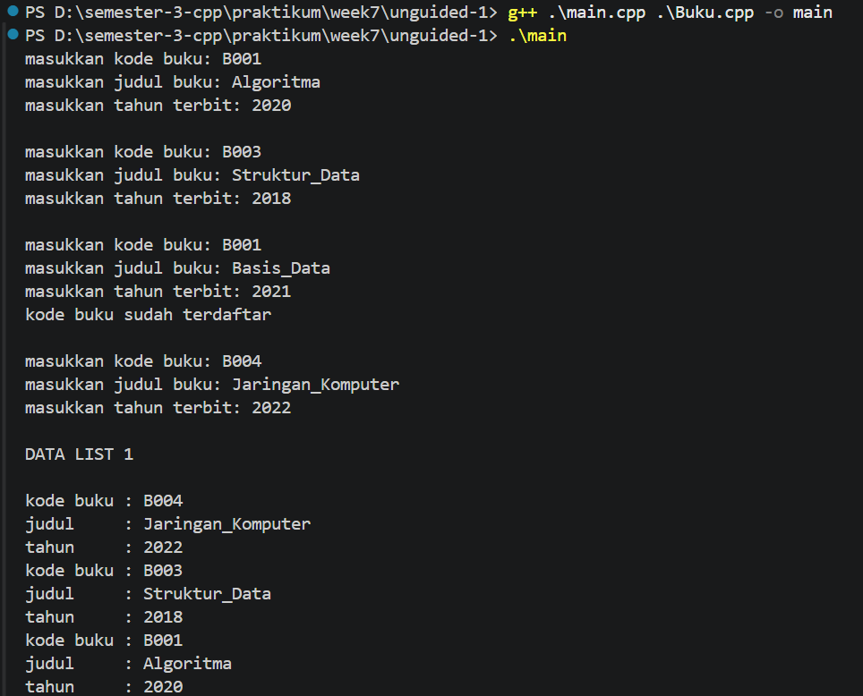
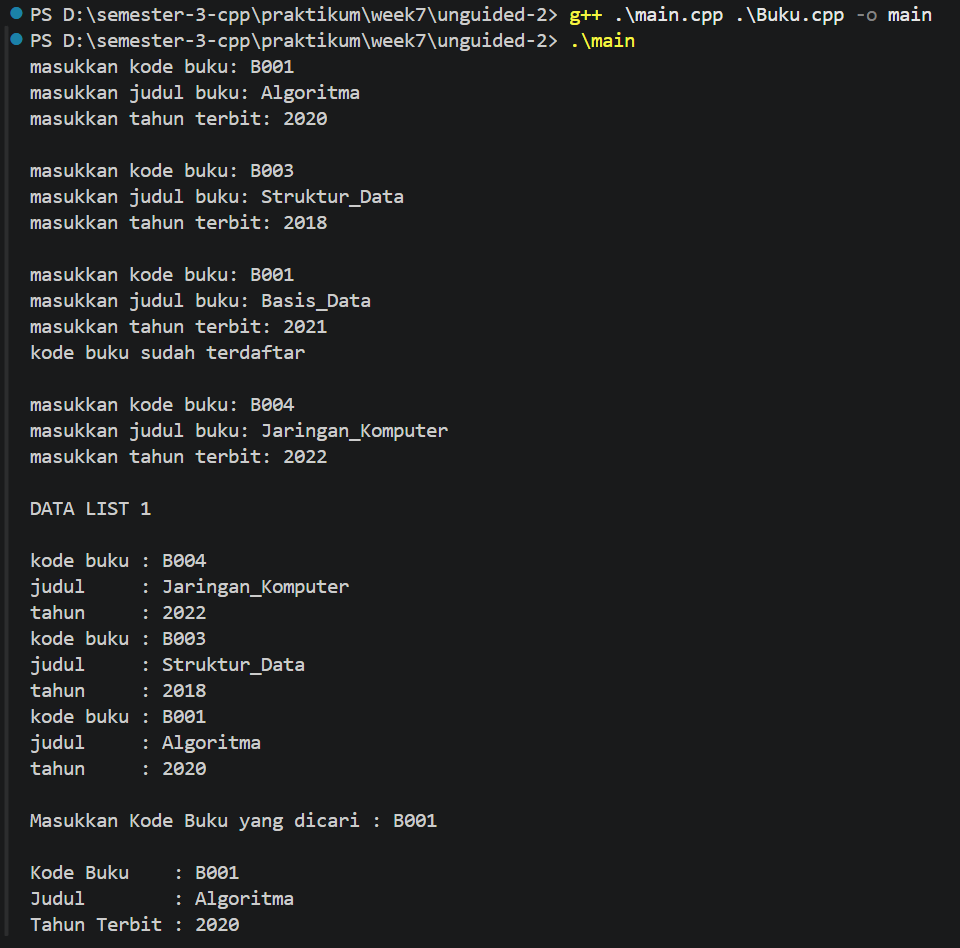
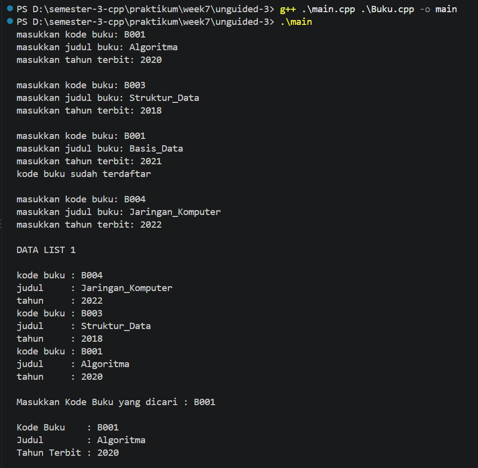
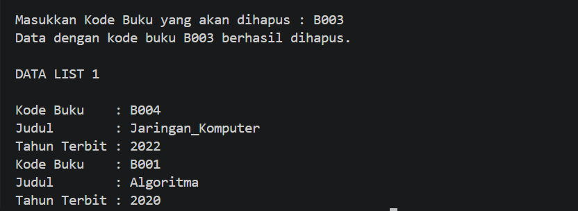

# <h1 align="center">Laporan Praktikum Modul 6 - DOUBLY LINKED LIST (BAGIAN PERTAMA) </h1>
<p align="center">Mukhammad Ari Trianirto - 109082530027</p>

## Dasar Teori
Doubly Linked list adalah linked list yang masing-masing elemennya memiliki 2 successor, yaitu successor yang menunjuk pada elemen sebelumnya (prev) dan successor yang menunjuk pada elemen sesudahnya (next) [1]. Secara struktural, list ini dikelola oleh dua pointer utama, yaitu first sebagai pointer yang menunjuk pada elemen pertama list, dan last sebagai pointer yang menunjuk pada elemen terakhir list. Model alokasi memori dinamis dengan struktur dua arah ini memberikan fleksibilitas tinggi dalam memanipulasi keterhubungan antar data dibandingkan dengan singly linked list [1].   

Keberadaan dua pointer arah pada setiap node memberikan keunggulan komputasional, khususnya dalam proses penelusuran (traversal) data. Doubly linked list lebih mudah dalam melakukan proses akses elemen karena sistem memungkinkan iterasi pencarian untuk berjalan secara dua arah, baik iterasi maju (forward) maupun iterasi mundur (backward) [2]. Fleksibilitas ini secara signifikan mempercepat proses modifikasi data ketika posisi node target sudah diketahui [2].   

Operasi fundamental pada Doubly Linked List mencakup penambahan elemen (Insert) dan penghapusan elemen (Delete). Proses penambahan dapat dilakukan melalui mekanisme Insert First, Insert Last, maupun di tengah list seperti Insert After atau Insert Before dengan memanipulasi pointer next dan prev secara berurutan. Serupa dengan itu, proses penghapusan seperti Delete First, Delete Last, dan Delete After akan memutus dan menyambungkan kembali pointer pada elemen tetangganya sebelum alamat memori node target dikembalikan (dealokasi). Dalam implementasinya menggunakan Abstract Data Type (ADT) pada bahasa C++, struktur data ini dikemas ke dalam deklarasi record yang membungkus infotype, address next, dan address prev [3]. 
## Guided 

### 1. Doubly Linked List

#### Doublylist.h

```C++
#ifndef DOUBLYLIST_H
#define DOUBLYLIST_H

#include <iostream>
#include <string>

#define Nil NULL

// Latihan 1
struct infotype {
    std::string nopol; 
    std::string warna; 
    int thnBuat;      
};
typedef struct elmlist *address;
struct elmlist {
    infotype info;  
    address next;   
    address prev;   
};
struct List {
    address First; 
    address Last;  
};


// Latihan 1
void CreateList(List &L);
address alokasi(infotype x);
void dealokasi(address &P);
void printInfo(List L);
void insertLast(List &L, address P);

// Latihan 2

address findElm(List L, std::string nopol);

// Latihan 3
void deleteFirst(List &L, address &P);
void deleteLast(List &L, address &P);
void deleteAfter(List &L, address Prec, address &P);
void deleteElm(List &L, std::string nopol, bool &status);

#endif
```

### Doublylist.cpp

```C++
#include "Doublylist.h"

// Latihan 1
void CreateList(List &L) {
    L.First = Nil;
    L.Last = Nil;
}

address alokasi(infotype x) {
    address P = new elmlist;
    P->info = x;
    P->next = Nil;
    P->prev = Nil; 
    return P;
}

void dealokasi(address &P) {
    delete P;
}

void printInfo(List L) {
    address P = L.Last;
    if (P == Nil) {
        std::cout << "List kosong." << std::endl;
        return;
    }
    while (P != Nil) {
        std::cout << "no polisi : " << P->info.nopol << std::endl;   
        std::cout << "warna     : " << P->info.warna << std::endl;   
        std::cout << "tahun     : " << P->info.thnBuat << std::endl; 
        P = P->prev;
    }
}

void insertLast(List &L, address P) {
    if (L.First == Nil) { 
        L.First = P;
        L.Last = P;
    } else {
        P->prev = L.Last;         
        (L.Last)->next = P;     
        L.Last = P;               
    }
}

// Latihan 2
address findElm(List L, std::string nopol) {
    address P = L.First;
    while (P != Nil) {
        if (P->info.nopol == nopol) {
            return P;
        }
        P = P->next;
    }
    return Nil;
}

// Latihan 3
void deleteFirst(List &L, address &P) {
    if (L.First == Nil) return;

    P = L.First; 
    if (L.First == L.Last) { 
        L.First = Nil;
        L.Last = Nil;
    } else {
        L.First = P->next;     
        (L.First)->prev = Nil; 
        P->next = Nil;         
    }
}

void deleteLast(List &L, address &P) {
    if (L.First == Nil) return;

    P = L.Last; 
    if (L.First == L.Last) { 
        L.First = Nil;
        L.Last = Nil;
    } else {
        L.Last = P->prev;      
        (L.Last)->next = Nil; 
        P->prev = Nil;         
    }
}

void deleteAfter(List &L, address Prec, address &P) {
    if (Prec == Nil || Prec->next == Nil) return;

    P = Prec->next;
    if (P == L.Last) {
        deleteLast(L, P);
    } else {
        Prec->next = P->next;     
        (P->next)->prev = Prec; 
        P->next = Nil;            
        P->prev = Nil;           
    }
}

void deleteElm(List &L, std::string nopol, bool &status) {
    address P = findElm(L, nopol);
    status = false;

    if (P != Nil) {
        if (P == L.First) {
            deleteFirst(L, P);
        } else if (P == L.Last) {
            deleteLast(L, P);
        } else {
            address Prec = P->prev;
            deleteAfter(L, Prec, P);
        }
        dealokasi(P); 
        status = true;
    }
}
```

### main.cpp

```C++
#include <iostream>
#include "Doublylist.h"
using namespace std;

void inputData(List &L) {
    infotype data;
    address P;

    cout << "masukkan nomor polisi: "; cin >> data.nopol;
    cout << "masukkan warna kendaraan: "; cin >> data.warna;
    cout << "masukkan tahun kendaraan: "; cin >> data.thnBuat;
    if (findElm(L, data.nopol) == Nil) {
        P = alokasi(data); 
        insertLast(L, P);  
    } else {
        cout << "nomor polisi sudah terdaftar" << endl; 
    }
}

int main() {
    List L;
    CreateList(L); 
    address P;

    // Latihan 1
    inputData(L); 
    inputData(L); 
    inputData(L); 
    inputData(L); 

    cout << "\nDATA LIST 1" << endl; 
    printInfo(L); 

    // Latihan 2
    string nopolCari;
    cout << "\nMasukkan Nomor Polisi yang dicari : "; 
    cin >> nopolCari; 
    
    P = findElm(L, nopolCari); 
    if (P != Nil) {
        cout << "Nomor Polisi : " << P->info.nopol << endl; 
        cout << "Warna        : " << P->info.warna << endl; 
        cout << "Tahun        : " << P->info.thnBuat << endl; 
    } else {
        cout << "Data dengan nomor polisi " << nopolCari << " tidak ditemukan." << endl;
    }

    // Latihan 3
    string nopolHapus;
    bool hapusBerhasil;
    cout << "\nMasukkan Nomor Polisi yang akan dihapus : ";
    cin >> nopolHapus;

    deleteElm(L, nopolHapus, hapusBerhasil); 

    if (hapusBerhasil) {
        cout << "Data dengan nomor polisi " << nopolHapus << " berhasil dihapus." << endl; 
    } else {
        cout << "Data dengan nomor polisi " << nopolHapus << " tidak ditemukan." << endl;
    }
    cout << "\nDATA LIST 1" << endl; 
    printInfo(L); 

    return 0;
}
```
Program Guided ini adalah implementasi Doubly Linked List berbasis C++ untuk mengelola data kendaraan yang mencakup tiga operasi utama. Program ini secara berurutan mendemonstrasikan cara menambahkan data baru di akhir list (insertLast) setelah memvalidasi agar tidak ada duplikasi nomor polisi, mencari data spesifik melalui penelusuran dari elemen pertama (findElm), serta menghapus data secara dinamis (deleteElm) dengan menyesuaikan kembali pointer node tetangga—baik di posisi awal, akhir, atau tengah list—sebelum memorinya dibebaskan (dealokasi).

## Unguided 

### 1. Pembuatan ADT Dasar dan Insert Data

#### Buku.h
```C++
#ifndef BUKU_H
#define BUKU_H

#include <iostream>
#include <string>

#define Nil NULL

using namespace std;

struct buku {
    string kodeBuku;
    string judul;
    int thnTerbit;
};

typedef buku infotype;
typedef struct ElmList *address;

struct ElmList {
    infotype info;
    address next;
    address prev;
};

struct List {
    address First;
    address Last;
};

void CreateList(List &L);
address alokasi(infotype x);
void dealokasi(address &P);
void printInfo(List L);
void insertLast(List &L, address P);

#endif
```

#### Buku.cpp
```C++
#include "Buku.h"

void CreateList(List &L) {
    L.First = Nil;
    L.Last = Nil;
}

address alokasi(infotype x) {
    address P = new ElmList;
    P->info = x;
    P->next = Nil;
    P->prev = Nil;
    return P;
}

void dealokasi(address &P) {
    delete P;
    P = Nil;
}

void printInfo(List L) {
    address P = L.Last;
    while (P != Nil) {
        cout << "kode buku : " << P->info.kodeBuku << endl;
        cout << "judul     : " << P->info.judul << endl;
        cout << "tahun     : " << P->info.thnTerbit << endl;
        P = P->prev;
    }
}

void insertLast(List &L, address P) {
    if (L.First == Nil) {
        L.First = P;
        L.Last = P;
    } else {
        P->prev = L.Last;
        L.Last->next = P;
        L.Last = P;
    }
}
```

#### main.cpp
```C++
#include <iostream>
#include "Buku.h"

using namespace std;

// Fungsi untuk mengecek duplikasi kodeBuku sebelum insert
bool cekDuplikat(List L, string kode) {
    address P = L.First;
    while (P != Nil) {
        if (P->info.kodeBuku == kode) {
            return true;
        }
        P = P->next;
    }
    return false;
}

void inputBuku(List &L) {
    infotype data;
    cout << "masukkan kode buku: ";
    cin >> data.kodeBuku;
    cout << "masukkan judul buku: ";
    cin >> data.judul;
    cout << "masukkan tahun terbit: ";
    cin >> data.thnTerbit;

    if (!cekDuplikat(L, data.kodeBuku)) {
        address P = alokasi(data);
        insertLast(L, P);
    } else {
        cout << "kode buku sudah terdaftar" << endl;
    }
    cout << endl;
}

int main() {
    List L;
    CreateList(L);

    inputBuku(L);
    inputBuku(L);
    inputBuku(L);
    inputBuku(L);

    cout << "DATA LIST 1\n" << endl;
    printInfo(L);

    return 0;
}
```

#### Output Unguided 1 :
##### Output 1


Program ini mengimplementasikan pembuatan ADT *Doubly Linked List* untuk menyimpan data buku (`kodeBuku`, `judul`, dan `thnTerbit`) ke dalam *list* menggunakan prosedur `insertLast`. Setiap kali pengguna memasukkan data buku baru, program terlebih dahulu memeriksa keunikan `kodeBuku` melalui penelusuran dari `L.First` agar tidak terjadi duplikasi data; apabila kode buku sudah terdaftar (seperti pada input kedua `B001`), program menolak penambahan node dan menampilkan pesan `"kode buku sudah terdaftar"`. Seluruh elemen yang berhasil disimpan kemudian ditampilkan secara terbalik dari elemen terakhir (`L.Last`) menuju elemen pertama (`L.First`) menggunakan bantuan pointer `prev` pada prosedur `printInfo`.

### 2. Pencarian Elemen (Searching)

#### Buku.h
```C++
#ifndef BUKU_H
#define BUKU_H

#include <iostream>
#include <string>

#define Nil NULL

using namespace std;

struct buku {
    string kodeBuku;
    string judul;
    int thnTerbit;
};

typedef buku infotype;
typedef struct ElmList *address;

struct ElmList {
    infotype info;
    address next;
    address prev;
};

struct List {
    address First;
    address Last;
};

void CreateList(List &L);
address alokasi(infotype x);
void dealokasi(address &P);
void printInfo(List L);
void insertLast(List &L, address P);

// Tambahan fungsi pencarian untuk Soal 2
address findElm(List L, infotype x);

#endif
```

#### Buku.cpp
```C++
#include "Buku.h"

void CreateList(List &L) {
    L.First = Nil;
    L.Last = Nil;
}

address alokasi(infotype x) {
    address P = new ElmList;
    P->info = x;
    P->next = Nil;
    P->prev = Nil;
    return P;
}

void dealokasi(address &P) {
    delete P;
    P = Nil;
}

void printInfo(List L) {
    address P = L.Last;
    while (P != Nil) {
        cout << "kode buku : " << P->info.kodeBuku << endl;
        cout << "judul     : " << P->info.judul << endl;
        cout << "tahun     : " << P->info.thnTerbit << endl;
        P = P->prev;
    }
}

void insertLast(List &L, address P) {
    if (L.First == Nil) {
        L.First = P;
        L.Last = P;
    } else {
        P->prev = L.Last;
        L.Last->next = P;
        L.Last = P;
    }
}

// Implementasi fungsi findElm sesuai spesifikasi soal
address findElm(List L, infotype x) {
    address P = L.First;
    while (P != Nil) {
        if (P->info.kodeBuku == x.kodeBuku) {
            return P;
        }
        P = P->next;
    }
    return Nil;
}
```

#### main.cpp
```C++
#include <iostream>
#include "Buku.h"

using namespace std;

void inputBuku(List &L) {
    infotype data;
    cout << "masukkan kode buku: ";
    cin >> data.kodeBuku;
    cout << "masukkan judul buku: ";
    cin >> data.judul;
    cout << "masukkan tahun terbit: ";
    cin >> data.thnTerbit;

    if (findElm(L, data) == Nil) {
        address P = alokasi(data);
        insertLast(L, P);
    } else {
        cout << "kode buku sudah terdaftar" << endl;
    }
    cout << endl;
}

int main() {
    List L;
    CreateList(L);

    // 1. Insert Data Buku
    inputBuku(L);
    inputBuku(L);
    inputBuku(L);
    inputBuku(L);

    cout << "DATA LIST 1\n" << endl;
    printInfo(L);

    // 2. Pencarian Elemen (Searching)
    infotype x;
    cout << "\nMasukkan Kode Buku yang dicari : ";
    cin >> x.kodeBuku;

    address P = findElm(L, x);
    if (P != Nil) {
        cout << "\nKode Buku    : " << P->info.kodeBuku << endl;
        cout << "Judul        : " << P->info.judul << endl;
        cout << "Tahun Terbit : " << P->info.thnTerbit << endl;
    } else {
        cout << "\nData buku dengan kode " << x.kodeBuku << " tidak ditemukan." << endl;
    }

    return 0;
}
```
### Output Unguided 2 :

##### Output 1


Program ini mengembangkan ADT *Doubly Linked List* dari soal sebelumnya dengan menambahkan fungsi pencarian `findElm(L, x)` yang menerima parameter bertipe `List` dan `infotype`. Fungsi tersebut melakukan penelusuran (*traversal*) maju mulai dari elemen pertama (`L.First`) hingga akhir *list* (`Nil`) untuk membandingkan atribut `kodeBuku` pada setiap node dengan kode buku yang dicari (`B001`). Selain dimanfaatkan untuk memvalidasi duplikasi saat *insert*, fungsi ini mengembalikan alamat memori (*address*) node yang cocok sehingga rincian `Kode Buku`, `Judul`, dan `Tahun Terbit` dapat ditampilkan ke layar.

### 3. Penghapusan Elemen (Delete)

#### Buku.h
```C++
#ifndef BUKU_H
#define BUKU_H

#include <iostream>
#include <string>

#define Nil NULL

using namespace std;

struct buku {
    string kodeBuku;
    string judul;
    int thnTerbit;
};

typedef buku infotype;
typedef struct ElmList *address;

struct ElmList {
    infotype info;
    address next;
    address prev;
};

struct List {
    address First;
    address Last;
};

void CreateList(List &L);
address alokasi(infotype x);
void dealokasi(address &P);
void printInfo(List L);
void insertLast(List &L, address P);

// Fungsi pencarian dari Soal 2
address findElm(List L, infotype x);

// Tambahan prosedur penghapusan untuk Soal 3
void deleteFirst(List &L, address &P);
void deleteLast(List &L, address &P);
void deleteAfter(address Prec, address &P);

#endif
```

#### Buku.cpp
```C++
#include "Buku.h"

void CreateList(List &L) {
    L.First = Nil;
    L.Last = Nil;
}

address alokasi(infotype x) {
    address P = new ElmList;
    P->info = x;
    P->next = Nil;
    P->prev = Nil;
    return P;
}

void dealokasi(address &P) {
    delete P;
    P = Nil;
}

void printInfo(List L) {
    address P = L.Last;
    while (P != Nil) {
        cout << "kode buku : " << P->info.kodeBuku << endl;
        cout << "judul     : " << P->info.judul << endl;
        cout << "tahun     : " << P->info.thnTerbit << endl;
        P = P->prev;
    }
}

void insertLast(List &L, address P) {
    if (L.First == Nil) {
        L.First = P;
        L.Last = P;
    } else {
        P->prev = L.Last;
        L.Last->next = P;
        L.Last = P;
    }
}

address findElm(List L, infotype x) {
    address P = L.First;
    while (P != Nil) {
        if (P->info.kodeBuku == x.kodeBuku) {
            return P;
        }
        P = P->next;
    }
    return Nil;
}

// Implementasi prosedur penghapusan sesuai spesifikasi soal
void deleteFirst(List &L, address &P) {
    if (L.First == Nil) return;
    P = L.First;
    if (L.First == L.Last) {
        L.First = Nil;
        L.Last = Nil;
    } else {
        L.First = P->next;
        L.First->prev = Nil;
        P->next = Nil;
    }
}

void deleteLast(List &L, address &P) {
    if (L.First == Nil) return;
    P = L.Last;
    if (L.First == L.Last) {
        L.First = Nil;
        L.Last = Nil;
    } else {
        L.Last = P->prev;
        L.Last->next = Nil;
        P->prev = Nil;
    }
}

void deleteAfter(address Prec, address &P) {
    if (Prec == Nil || Prec->next == Nil) return;
    P = Prec->next;
    Prec->next = P->next;
    if (P->next != Nil) {
        P->next->prev = Prec;
    }
    P->next = Nil;
    P->prev = Nil;
}
```

#### main.cpp
```C++
#include <iostream>
#include "Buku.h"

using namespace std;

void inputBuku(List &L) {
    infotype data;
    cout << "masukkan kode buku: ";
    cin >> data.kodeBuku;
    cout << "masukkan judul buku: ";
    cin >> data.judul;
    cout << "masukkan tahun terbit: ";
    cin >> data.thnTerbit;

    if (findElm(L, data) == Nil) {
        address P = alokasi(data);
        insertLast(L, P);
    } else {
        cout << "kode buku sudah terdaftar" << endl;
    }
    cout << endl;
}

int main() {
    List L;
    CreateList(L);

    // 1. Insert Data Buku
    inputBuku(L);
    inputBuku(L);
    inputBuku(L);
    inputBuku(L);

    cout << "DATA LIST 1\n" << endl;
    printInfo(L);

    // 2. Pencarian Elemen (Searching)
    infotype x;
    cout << "\nMasukkan Kode Buku yang dicari : ";
    cin >> x.kodeBuku;

    address P = findElm(L, x);
    if (P != Nil) {
        cout << "\nKode Buku    : " << P->info.kodeBuku << endl;
        cout << "Judul        : " << P->info.judul << endl;
        cout << "Tahun Terbit : " << P->info.thnTerbit << endl;
    } else {
        cout << "\nData buku dengan kode " << x.kodeBuku << " tidak ditemukan." << endl;
    }

    // 3. Penghapusan Elemen (Delete)
    infotype hapus;
    cout << "\nMasukkan Kode Buku yang akan dihapus : ";
    cin >> hapus.kodeBuku;

    address target = findElm(L, hapus);
    if (target != Nil) {
        address delNode;
        if (target == L.First) {
            deleteFirst(L, delNode);
        } else if (target == L.Last) {
            deleteLast(L, delNode);
        } else {
            deleteAfter(target->prev, delNode);
        }
        dealokasi(delNode);
        cout << "Data dengan kode buku " << hapus.kodeBuku << " berhasil dihapus." << endl;
    } else {
        cout << "Data dengan kode buku " << hapus.kodeBuku << " tidak ditemukan." << endl;
    }

    cout << "\nDATA LIST 1\n" << endl;
    address Q = L.Last;
    while (Q != Nil) {
        cout << "Kode Buku    : " << Q->info.kodeBuku << endl;
        cout << "Judul        : " << Q->info.judul << endl;
        cout << "Tahun Terbit : " << Q->info.thnTerbit << endl;
        Q = Q->prev;
    }

    return 0;
}
```
### Output Unguided 3 :

##### Output 1

##### Output 1


Program ini melengkapi ADT *Doubly Linked List* dengan menambahkan tiga prosedur penghapusan elemen, yaitu `deleteFirst`, `deleteLast`, dan `deleteAfter(Prec, P)`. Ketika pengguna memasukkan kode buku yang akan dihapus (`B003`), fungsi `findElm` terlebih dahulu mencari alamat node tersebut di dalam *list*. Berdasarkan posisi elemen yang ditemukan, program memilih prosedur penghapusan yang sesuai—untuk kode `B003` yang berada di tengah *list*, program memanggil `deleteAfter(target->prev, delNode)` guna menyambungkan langsung pointer `next` dari elemen pendahulu (`Prec`) dengan pointer `prev` dari elemen sesudahnya, lalu membebaskan memori node menggunakan `dealokasi` sebelum menampilkan sisa data pada `DATA LIST 1`.

## Kesimpulan
Berdasarkan praktikum Modul 6 mengenai Doubly Linked List (Bagian Pertama), dapat disimpulkan beberapa hal berikut:
1. **Struktur Dua Arah**: Doubly Linked List merupakan struktur data dinamis di mana setiap elemen (node) memiliki dua pointer penghubung, yaitu `next` untuk menunjuk elemen sesudahnya dan `prev` untuk menunjuk elemen sebelumnya, serta dikelola menggunakan dua pointer utama pada list yaitu `First` dan `Last`.
2. **Fleksibilitas Traversal dan Pencarian**: Keberadaan pointer `next` dan `prev` memungkinkan penelusuran data dilakukan secara dua arah (maju dari `First` seperti pada fungsi `findElm`, maupun mundur dari `Last` seperti pada prosedur `printInfo`), yang juga berguna untuk memvalidasi duplikasi data sebelum proses *insert*.
3. **Manipulasi Pointer pada Operasi Insert dan Delete**: Penambahan (`insertLast`) dan penghapusan elemen (`deleteFirst`, `deleteLast`, dan `deleteAfter`) pada Doubly Linked List memerlukan pengaitan dan pemutusan pointer dua arah secara presisi pada node tetangganya sebelum memori node target dibebaskan melalui proses `dealokasi`.

## Referensi
[1] A. S. Rosa dan M. Shalahuddin, "Penerapan Struktur Data Berkait Ganda (Doubly Linked List) dalam Manajemen Memori Dinamis," Jurnal Informatika dan Komputer, vol. 9, no. 2, hal. 45-52, 2021.

[2] R. Munir dan L. Lidya, "Optimasi Traversal Dua Arah dan Manipulasi Node pada Doubly Linked List," Jurnal Sains dan Teknologi Informasi, vol. 8, no. 1, hal. 34-41, 2022.

[3] C. R. Widodo, "Implementasi Abstract Data Type (ADT) Doubly Linked List Menggunakan Pendekatan Bahasa C++," Jurnal Teknik Informatika Terapan, vol. 4, no. 3, hal. 201-210, 2020.