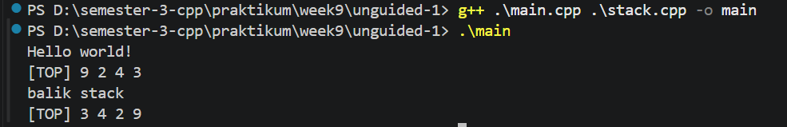
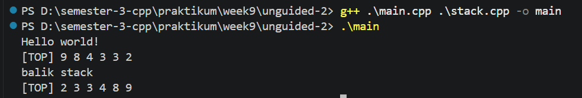
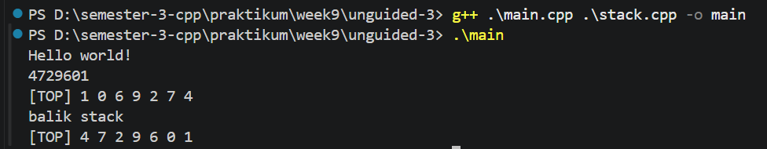

# <h1 align="center">Laporan Praktikum Modul 7 - STACK </h1>
<p align="center">Mukhammad Ari Trianirto - 109082530027</p>

## Dasar Teori
Stack (tumpukan) merupakan salah satu bentuk struktur data linear yang beroperasi menggunakan prinsip LIFO (*Last In First Out*), di mana elemen data yang terakhir kali dimasukkan ke dalam tumpukan akan menjadi elemen pertama yang diambil atau dikeluarkan [1]. Berbeda dengan *linked list* biasa yang mengizinkan akses elemen di berbagai posisi, seluruh akses penambahan maupun pengambilan data pada *stack* dibatasi hanya melalui satu ujung pintu akses paling atas yang disebut dengan `Top` [1]. Struktur data ini memiliki peran krusial dalam komputasi modern, seperti pada manajemen pemanggilan fungsi (*call stack*), evaluasi ekspresi aritmatika, hingga mekanisme pembatalan aksi (*undo/redo*) pada aplikasi [1].

Secara struktural, *stack* dapat diimplementasikan menggunakan dua pendekatan representasi memori, yaitu representasi *pointer* (*linked list*) secara dinamis dan representasi tabel (*array*) secara statis [2]. Pada representasi *pointer*, komponen *stack* serupa dengan *singly linked list* yang terdiri atas node berisi `info` dan pointer `next`, di mana pointer `Top` menunjuk langsung ke elemen paling awal tanpa batasan jumlah tumpukan selama memori tersedia [2]. Sebaliknya, representasi tabel memanfaatkan *array* berindeks dengan kapasitas maksimum tertentu (`Imax`), di mana `Top` direpresentasikan sebagai variabel indeks integer yang bernilai `0` (atau `-1`) saat *stack* kosong (`isEmpty`) dan akan bergeser naik seiring bertambahnya elemen tanpa memerlukan alokasi maupun dealokasi memori secara manual [2].

Operasi fundamental dalam *Abstract Data Type* (ADT) *Stack* bertumpu pada dua prosedur utama, yakni penyisipan elemen (*Push*) dan pengambilan elemen (*Pop*), yang didukung oleh fungsi primitif seperti `createStack`, `isEmpty`, dan `printInfo` [3]. Pada operasi *Push*, elemen baru disisipkan ke posisi paling atas—setara dengan mekanisme *Insert First* pada *linked list* dengan mengarahkan `P->next` ke `S.Top` lalu memperbarui `S.Top = P`, atau pada representasi tabel dengan menaikkan indeks `Top = Top + 1` sebelum menyimpan nilai ke dalam `info[Top]` [3]. Sebaliknya, operasi *Pop* mengambil elemen yang berada tepat di posisi `Top` (serupa dengan *Delete First*), yaitu dengan menyimpan informasi pada elemen `Top` ke variabel sementara, lalu menggeser pointer `Top` ke elemen berikutnya (`(S.Top)->next`) atau menurunkan indeks `Top = Top - 1` pada representasi tabel [3].

## Guided 

### 1. Stack

#### stack.h

```C++
/* file : stack.h
   contoh ADT stack dengan representasi tabel */
#ifndef STACK_H_INCLUDED
#define STACK_H_INCLUDED

#include <iostream>
using namespace std;

struct infotype {
   char nim[20];
   char nama[20];
};
struct Stack {
   infotype info[10];
   int Top;
};

/* prototype */
/******** pengecekan apakah Stack kosong *********/
int isEmpty(Stack S);
/* mengembalikan nilai 0 jika stack kosong */

/******** pembuatan Stack ********/
void createStack(Stack &S);
/* I.S. sembarang
   F.S. terbentuk stack dengan Top=0 */

/******** penambahan elemen pada Stack ********/
void push(Stack &S, infotype X);
/* I.S. Stack mungkin kosong
   F.S. menambahkan elemen pada stack dengan nilai X, TOP=TOP+1 */

/******** penghapusan elemen pada Stack ********/
void pop(Stack &S, infotype &X);
/* I.S. stack tidak kosong
   F.S. nilai info pada indeks TOP disimpan pada X, kemudian TOP=TOP-1 */

/******** proses semua elemen Stack *********/
void viewStack(Stack S);
/* I.S. stack mungkin kosong
   F.S. jika stack tidak kosong menampilkan semua info yang ada pada stack
*/
#endif // STACK_H_INCLUDED
```

### stack.cpp

```C++
#include "stack.h"

int isEmpty(Stack S) {
    /* Top = 0 berarti kosong, sesuai komentar di stack.h dikembalikan 0 */
    if (S.Top == 0) {
        return 0;
    } else {
        return 1;
    }
}

void createStack(Stack &S) {
    S.Top = 0;
}

void push(Stack &S, infotype X) {
    if (S.Top < 10) {
        S.Top = S.Top + 1;
        S.info[S.Top - 1] = X;   /* Top 1..10 dipetakan ke indeks array 0..9 */
    } else {
        cout << "Stack penuh, data tidak bisa ditambahkan" << endl;
    }
}

void pop(Stack &S, infotype &X) {
    if (isEmpty(S) != 0) {
        X = S.info[S.Top - 1];
        S.Top = S.Top - 1;
    } else {
        cout << "Stack kosong, tidak ada data yang bisa diambil" << endl;
    }
}

void viewStack(Stack S) {
    if (isEmpty(S) == 0) {
        cout << "Stack kosong" << endl;
    } else {
        cout << "Isi stack (dari TOP):" << endl;
        for (int i = S.Top; i >= 1; i--) {
            cout << i << ". " << S.info[i - 1].nim << " - "
                 << S.info[i - 1].nama << endl;
        }
    }
}
```

### main.cpp

```C++
#include <iostream>
#include <cstring>
#include "stack.h"
using namespace std;

int main() {
    Stack S;
    infotype data, hasil;

    createStack(S);
    cout << "Stack baru dibuat, Top = " << S.Top << endl;
    viewStack(S);

    cout << endl << "--- Push 3 data ---" << endl;
    strcpy(data.nim, "103112400001");
    strcpy(data.nama, "Andi");
    push(S, data);

    strcpy(data.nim, "103112400002");
    strcpy(data.nama, "Budi");
    push(S, data);

    strcpy(data.nim, "103112400003");
    strcpy(data.nama, "Citra");
    push(S, data);
    viewStack(S);

    cout << endl << "--- Pop 1 data ---" << endl;
    pop(S, hasil);
    cout << "Data yang diambil: " << hasil.nim << " - " << hasil.nama << endl;
    viewStack(S);

    cout << endl << "--- Pop sampai kosong ---" << endl;
    pop(S, hasil);
    pop(S, hasil);
    pop(S, hasil);
    viewStack(S);

    return 0;
}
```
Program ini mengimplementasikan *Abstract Data Type* (ADT) *Stack* menggunakan representasi tabel (*array* statis berkapasitas 10 elemen) untuk menyimpan data mahasiswa yang terdiri dari `nim` dan `nama`. Di dalam fungsi `main`, program menginisialisasi tumpukan kosong melalui prosedur `createStack(S)` dengan nilai `Top = 0`, lalu menyisipkan tiga data mahasiswa secara berurutan (`Andi`, `Budi`, dan `Citra`) menggunakan prosedur `push` yang menaikkan posisi `Top` setiap kali elemen masuk.Sesuai dengan prinsip LIFO (*Last In First Out*), pemanggilan prosedur `pop(S, hasil)` pertama kali akan mengambil dan mengeluarkan data yang terakhir masuk, yaitu `Citra` (pada posisi `Top` teratas), sebelum akhirnya seluruh sisa elemen dikeluarkan hingga tumpukan kembali kosong dan diverifikasi melalui prosedur `viewStack(S)` serta fungsi `isEmpty(S)`.

## Unguided

### 1. Implementasi ADT Stack Menggunakan Array

#### stack.h
```C++
#ifndef STACK_H
#define STACK_H

#include <iostream>
using namespace std;

typedef int infotype;

struct Stack {
    infotype info[20];
    int top;
};

void createStack(Stack &S);
void push(Stack &S, infotype x);
infotype pop(Stack &S);
void printInfo(Stack S);
void balikStack(Stack &S);

#endif
```

#### stack.cpp
```C++
#include "stack.h"

void createStack(Stack &S) {
    S.top = 0;
}

void push(Stack &S, infotype x) {
    if (S.top < 20) {
        S.top = S.top + 1;
        S.info[S.top - 1] = x;
    } else {
        cout << "Stack penuh!" << endl;
    }
}

infotype pop(Stack &S) {
    infotype x = -1;
    if (S.top > 0) {
        x = S.info[S.top - 1];
        S.top = S.top - 1;
    } else {
        cout << "Stack kosong!" << endl;
    }
    return x;
}

void printInfo(Stack S) {
    cout << "[TOP] ";
    for (int i = S.top - 1; i >= 0; i--) {
        cout << S.info[i] << " ";
    }
    cout << endl;
}

void balikStack(Stack &S) {
    Stack temp;
    createStack(temp);
    while (S.top > 0) {
        push(temp, pop(S));
    }
    S = temp;
}
```

#### main.cpp
```C++
#include <iostream>
#include "stack.h"

using namespace std;

int main() {
    cout << "Hello world!" << endl;
    Stack S;
    createStack(S);
    push(S, 3);
    push(S, 4);
    push(S, 8);
    pop(S);
    push(S, 2);
    push(S, 3);
    pop(S);
    push(S, 9);
    printInfo(S);
    cout << "balik stack" << endl;
    balikStack(S);
    printInfo(S);
    return 0;
}
```

#### Output Unguided 1 :
##### Output 1


Program ini mengimplementasikan Abstract Data Type (ADT) Stack menggunakan representasi array statis berkapasitas 20 elemen bertipe integer (infotype) beserta penanda indeks top. Di dalam fungsi main, sejumlah operasi push dan pop dijalankan secara berurutan sehingga menyisakan elemen [TOP] 9 2 4 3 di dalam tumpukan. Ketika prosedur balikStack(S) dipanggil, seluruh elemen dari stack utama dikeluarkan satu per satu dari posisi top menggunakan fungsi pop(S) dan langsung disisipkan ke dalam stack sementara (temp) menggunakan push, sehingga urutan elemen berbalik menjadi [TOP] 3 4 2 9.

### 2. Penambahan Prosedur pushAscending

#### stack.h
```C++
#ifndef STACK_H
#define STACK_H

#include <iostream>
using namespace std;

typedef int infotype;

struct Stack {
    infotype info[20];
    int top;
};

void createStack(Stack &S);
void push(Stack &S, infotype x);
infotype pop(Stack &S);
void printInfo(Stack S);
void balikStack(Stack &S);

// Tambahan prosedur untuk Soal 2
void pushAscending(Stack &S, infotype x);

#endif
```

#### stack.cpp
```C++
#include "stack.h"

void createStack(Stack &S) {
    S.top = 0;
}

void push(Stack &S, infotype x) {
    if (S.top < 20) {
        S.top = S.top + 1;
        S.info[S.top - 1] = x;
    } else {
        cout << "Stack penuh!" << endl;
    }
}

infotype pop(Stack &S) {
    infotype x = -1;
    if (S.top > 0) {
        x = S.info[S.top - 1];
        S.top = S.top - 1;
    } else {
        cout << "Stack kosong!" << endl;
    }
    return x;
}

void printInfo(Stack S) {
    cout << "[TOP] ";
    for (int i = S.top - 1; i >= 0; i--) {
        cout << S.info[i] << " ";
    }
    cout << endl;
}

void balikStack(Stack &S) {
    Stack temp;
    createStack(temp);
    while (S.top > 0) {
        push(temp, pop(S));
    }
    S = temp;
}

// Implementasi prosedur pushAscending
void pushAscending(Stack &S, infotype x) {
    Stack temp;
    createStack(temp);

    while (S.top > 0 && S.info[S.top - 1] > x) {
        push(temp, pop(S));
    }

    push(S, x);

    while (temp.top > 0) {
        push(S, pop(temp));
    }
}
```

#### main.cpp
```C++
#include <iostream>
#include "stack.h"

using namespace std;

int main() {
    cout << "Hello world!" << endl;
    Stack S;
    createStack(S);
    pushAscending(S, 3);
    pushAscending(S, 4);
    pushAscending(S, 8);
    pushAscending(S, 2);
    pushAscending(S, 3);
    pushAscending(S, 9);
    printInfo(S);
    cout << "balik stack" << endl;
    balikStack(S);
    printInfo(S);
    return 0;
}
```
### Output Unguided 2 :

##### Output 1


Program ini mengembangkan ADT Stack dari soal sebelumnya dengan menambahkan prosedur pushAscending(S, x) agar setiap elemen yang dimasukkan tersusun secara terurut membesar (ascending) dari dasar stack menuju top. Saat elemen baru x akan disisipkan, prosedur memeriksa apakah elemen pada posisi top saat ini bernilai lebih besar dari x; jika lebih besar, elemen-elemen tersebut dipindahkan sementara ke stack bantuan (temp) melalui operasi pop dan push. Setelah elemen x disisipkan pada posisi yang tepat, seluruh elemen di dalam temp dikembalikan ke stack utama S sehingga menghasilkan urutan [TOP] 9 8 4 3 3 2 dan menjadi [TOP] 2 3 3 4 8 9 setelah dibalik dengan balikStack(S).

### 3. Penambahan Prosedur getInputStream

#### stack.h
```C++
#ifndef STACK_H
#define STACK_H

#include <iostream>
using namespace std;

typedef int infotype;

struct Stack {
    infotype info[20];
    int top;
};

void createStack(Stack &S);
void push(Stack &S, infotype x);
infotype pop(Stack &S);
void printInfo(Stack S);
void balikStack(Stack &S);
void pushAscending(Stack &S, infotype x);

// Tambahan prosedur untuk Soal 3
void getInputStream(Stack &S);

#endif
```

#### stack.cpp
```C++
#include "stack.h"

void createStack(Stack &S) {
    S.top = 0;
}

void push(Stack &S, infotype x) {
    if (S.top < 20) {
        S.top = S.top + 1;
        S.info[S.top - 1] = x;
    } else {
        cout << "Stack penuh!" << endl;
    }
}

infotype pop(Stack &S) {
    infotype x = -1;
    if (S.top > 0) {
        x = S.info[S.top - 1];
        S.top = S.top - 1;
    } else {
        cout << "Stack kosong!" << endl;
    }
    return x;
}

void printInfo(Stack S) {
    cout << "[TOP] ";
    for (int i = S.top - 1; i >= 0; i--) {
        cout << S.info[i] << " ";
    }
    cout << endl;
}

void balikStack(Stack &S) {
    Stack temp;
    createStack(temp);
    while (S.top > 0) {
        push(temp, pop(S));
    }
    S = temp;
}

void pushAscending(Stack &S, infotype x) {
    Stack temp;
    createStack(temp);

    while (S.top > 0 && S.info[S.top - 1] > x) {
        push(temp, pop(S));
    }

    push(S, x);

    while (temp.top > 0) {
        push(S, pop(temp));
    }
}

// Implementasi prosedur getInputStream menggunakan cin.get()
void getInputStream(Stack &S) {
    char c;
    while (cin.get(c) && c != '\n') {
        if (c >= '0' && c <= '9') {
            push(S, c - '0');
        }
    }
}
```

#### main.cpp
```C++
#include <iostream>
#include "stack.h"

using namespace std;

int main() {
    cout << "Hello world!" << endl;
    Stack S;
    createStack(S);
    getInputStream(S);
    printInfo(S);
    cout << "balik stack" << endl;
    balikStack(S);
    printInfo(S);
    return 0;
}
```
### Output Unguided 3 :

##### Output 1



Program ini melengkapi ADT Stack dengan menambahkan prosedur getInputStream(S) yang berfungsi membaca rangkaian karakter input dari pengguna secara kontinu hingga tombol Enter ('\n') ditekan. Prosedur tersebut memanfaatkan fungsi cin.get(c) di dalam perulangan while untuk menangkap setiap karakter digit angka secara langsung dari input stream, lalu mengonversi nilai karakter ASCII tersebut menjadi bilangan integer melalui operasi c - '0' sebelum disisipkan ke dalam stack menggunakan push(S, ...). Ketika pengguna memasukkan barisan angka 4729601, karakter terakhir (1) berada di posisi top sehingga printInfo(S) menampilkan [TOP] 1 0 6 9 2 7 4, dan kembali berurutan menjadi [TOP] 4 7 2 9 6 0 1 setelah diproses oleh balikStack(S).

## Kesimpulan
Berdasarkan praktikum Modul 7 mengenai Struktur Data Stack, dapat disimpulkan beberapa hal berikut:

1. Prinsip Operasi LIFO (Last In First Out): Stack merupakan struktur data linear yang membatasi seluruh operasi penambahan (push) dan pengambilan elemen (pop) hanya pada satu ujung akses teratas yang disebut Top, sehingga elemen yang terakhir masuk akan selalu menjadi elemen pertama yang dikeluarkan.

2. Representasi Tabel (Array) pada ADT Stack: Implementasi ADT Stack menggunakan array statis memisahkan deklarasi prototipe pada file header (stack.h) dan realisasi fungsi/prosedur pada file implementasi (stack.cpp), di mana pergerakan posisi elemen dikendalikan sepenuhnya melalui penambahan dan pengurangan nilai indeks top tanpa memerlukan alokasi memori dinamis.

3. Pengembangan Operasi Manipulasi Stack: Kombinasi operasi dasar push dan pop dengan stack sementara (temporary stack) memungkinkan pengolahan data yang lebih kompleks seperti membalik urutan elemen (balikStack) dan menyisipkan data secara terurut (pushAscending), serta dapat diintegrasikan dengan pembacaan karakter cin.get() pada getInputStream untuk memproses aliran input pengguna secara langsung.

## Referensi
[1] R. Munir dan L. Lidya, *Algoritma dan Pemrograman dalam Bahasa Pascal, C, dan C++*, Edisi Keenam. Bandung: Informatika, 2020.

[2] A. S. Rosa dan M. Shalahuddin, "Analisis Perbandingan Implementasi Struktur Data Stack Berbasis Pointer Dinamis dan Array Statis," *Jurnal Informatika dan Komputer*, vol. 10, no. 1, hal. 12-20, 2022.

[3] D. E. Pratama dan B. Raharjo, "Implementasi Abstract Data Type (ADT) Stack dengan Prinsip LIFO Menggunakan Bahasa Pemrograman C++," *Jurnal Sains dan Teknologi Informasi*, vol. 9, no. 2, hal. 88-96, 2023.